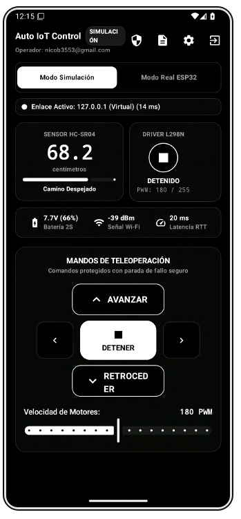
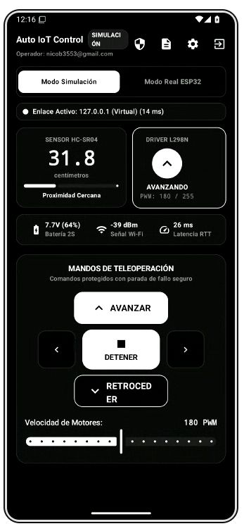
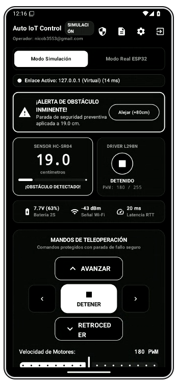
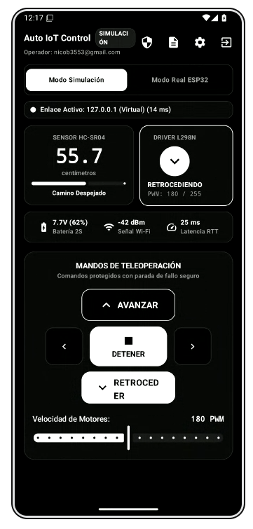

# Auto IoT Control — Estación de Monitoreo y Teleoperación (Vehículo IoT ESP32)

Aplicación móvil nativa Android desarrollada en **Kotlin** con **Jetpack Compose (Material 3)** y arquitectura **MVVM limpia**, diseñada como **Estación Comercial de Monitoreo y Teleoperación** de un Vehículo Autónomo / Móvil de Inspección IoT basado en **ESP32** (sensor ultrasónico **HC-SR04**, puente H **L298N** y **LED de advertencia**), con selector dual (**Modo Simulación Integrado** y **Modo Real ESP32 Wi-Fi**), cumpliendo rigurosamente con los estándares de ciberseguridad **ISO/IEC 27400**, interfaz en **Negro y Blanco (OLED High-Contrast)** y tolerancia a fallos.

---

## 1. Pantallazos Descriptivos de la Aplicación (Presentación Comercial)

Los siguientes pantallazos reales de la aplicación están incluidos en la carpeta [`docs/screenshots/`](docs/screenshots/) del repositorio y demuestran el flujo completo de teleoperación y seguridad anticolisión:

| 1. Estado de Reposo y Camino Despejado (`68.2 cm`) | 2. Teleoperación en Marcha (`AVANZANDO - 31.8 cm`) |
| :---: | :---: |
|  |  |
| **Monitoreo en Reposo:** Interfaz monocromática OLED con lectura en vivo del sensor **HC-SR04** (`68.2 cm`), driver L298N en **`DETENIDO`**, batería Li-Ion 2S (**`7.7V - 66%`**), señal Wi-Fi (**`-39 dBm`**) y latencia RTT (**`20 ms`**). | **Tracción Activa y Proximidad:** Botón **`AVANZAR`** iluminado en blanco de alto contraste, motor en estado **`AVANZANDO`** a velocidad de **`180 PWM`** y reducción de distancia en tiempo real a **`31.8 cm`**. |

| 3. Parada de Seguridad Anticolisión (`19.0 cm`) | 4. Maniobra de Escape y Reversa (`RETROCEDIENDO - 55.7 cm`) |
| :---: | :---: |
|  |  |
| **Protección Anticolisión Automática (Fail-Safe):** Al detectar distancia $\le 20\text{ cm}$, se despliega el banner superior **`¡ALERTA DE OBSTÁCULO INMINENTE!`**, los motores se cortan automáticamente a **`DETENIDO`** y se ofrece el botón **`Alejar (+80cm)`**. | **Despeje y Recuperación Segura:** Maniobra con mando **`RETROCEDER`** activo, motor en **`RETROCEDIENDO`**, incremento progresivo de distancia hasta **`55.7 cm`** y retorno inmediato al estado de **`Camino Despejado`**. |

---

## 2. Organización Limpia de la Interfaz, Modo Negro y Blanco y Alta Legibilidad

La interfaz ha sido diseñada bajo un esquema **Monocromático de Alto Contraste (Negro y Blanco)** optimizado para pantallas OLED/AMOLED, reduciendo el consumo de batería y ofreciendo máxima legibilidad tanto en interiores como bajo luz solar directa:

1. **Panel Superior de Telemetría**:
   - **Sensor Ultrasónico HC-SR04**: Indicador numérico en tipografía monoespaciada de gran tamaño con barra de proximidad dinámica y alerta de distancia crítica.
   - **Driver de Motores L298N**: Visualizador del estado operativo actual (`STOPPED`, `FORWARD`, `BACKWARD`, `LEFT`, `RIGHT`) y nivel de potencia PWM actual.
   - **Métricas de Hardware**: Voltaje de batería Li-Ion 2S (`7.7V`), nivel de señal Wi-Fi (`RSSI en dBm`) y tiempo de latencia de red (`ms`).
2. **Cruceta Direccional y Gran Botón Central `DETENER`**:
   - Mandos ergonómicos táctiles: **`AVANZAR`**, **`RETROCEDER`**, **`GIRAR IZQUIERDA`**, **`GIRAR DERECHA`** y un botón central prominente de **`DETENER / PARADA DE EMERGENCIA`** en blanco puro sobre fondo negro.
   - Deslizador de velocidad de motor PWM en tiempo real con rango de 100 a 255.
3. **Soporte Completo para Rotación de Pantalla**:
   - Mantiene la sesión, conexión y telemetría íntegras al girar el dispositivo (Vertical ↔ Horizontal) mediante arquitectura reactiva con `StateFlow` y `ViewModel`.

---

## 3. Conexión Inalámbrica y Operación (Modo Simulación vs. ESP32 Real)

La aplicación cuenta con un selector segmentado superior para alternar de forma limpia y transparente entre dos entornos de trabajo:

### Opción A: Modo Simulación Integrado (Pruebas Inmediatas sin Hardware)
Permite probar y evaluar todas las funciones del sistema en el teléfono Android antes de disponer físicamente del prototipo ESP32 ensamblado:
1. Inicie sesión y asegúrese de que el selector superior esté en **`Modo Simulación`**.
2. Presione **`AVANZAR`**: el simulador de física vehicular reducirá progresivamente la distancia ultrasónica emulando el avance hacia un obstáculo.
3. Al alcanzar una distancia crítica ($\le 20\text{ cm}$), el sistema activa de forma autónoma la **Parada Preventiva**, hace vibrar el teléfono, bloquea el avance y despliega la alerta **`¡ALERTA DE OBSTÁCULO INMINENTE!`**.
4. Presione **`RETROCEDER`** para aumentar la distancia de forma segura o utilice el botón **`Alejar (+80cm)`** para restablecer la distancia en cualquier momento.

### Opción B: Modo Real con Microcontrolador ESP32 (Wi-Fi Local)
1. Cargue en el ESP32 el firmware provisto en `firmware/esp32_autoiot_car.ino`.
2. Encienda el vehículo. El ESP32 creará su propia red Wi-Fi:
   - **SSID:** `AutoIoT_Car_AP`
   - **Contraseña:** `AutoIoT2026`
   - **IP Predeterminada:** `192.168.4.1` (Puerto 80)
3. Conecte su teléfono Android a la red Wi-Fi del vehículo.
4. En la app, cambie el selector a **`Modo Real ESP32`**.
5. Desde el ícono de ajustes (engranaje), puede personalizar la IP, el puerto o presionar **`Probar Conexión / Ping Real`** para medir la latencia de respuesta en milisegundos.

---

## 4. Gestión de Cuentas y Seguridad Criptográfica (ISO/IEC 27400)

La aplicación aplica estrictamente los principios de ciberseguridad del estándar internacional **ISO/IEC 27400**:

1. **Cero Contraseñas en Texto Plano**:
   - Cada contraseña es procesada mediante un algoritmo de resumen criptográfico **SHA-256** complementado con un **Salt aleatorio de 16 bytes (`SecureRandom`)**. La contraseña original jamás se almacena en memoria secundaria ni en logs.
2. **Llaves Maestras en Hardware (`AndroidKeyStore`)**:
   - Los identificadores y tokens temporales de sesión se cifran con **AES-256-GCM** (Galois/Counter Mode con etiqueta de autenticación de 128 bits), garantizando confidencialidad e integridad física contra manipulación de datos.
3. **Credenciales de Evaluación Docente (Acceso Rápido)**:
   - **Correo / Operador:** `operador@autoiot.com`
   - **Contraseña:** `AutoIoT2026!`
   - *O pulse el botón:* **`⚡ Cargar Credenciales TI3042 (Docente)`** en la pantalla de inicio.
4. **Registro de Operadores y Cierre de Sesión Seguro**:
   - Permite crear nuevas cuentas locales con asignación de rol (`Operador de Campo`, `Auditor`, `Supervisor`). Al cerrar sesión, las claves y tokens efímeros son revocados y eliminados de forma inmediata.

---

## 5. Arquitectura MVVM y Protocolo de Comunicación

### 5.1 Estructura Modular por Paquetes
- `com.example.data.security`: `CryptoManager.kt` (`AndroidKeyStore` + `AES-256-GCM` + `SHA-256 Salt 16B`), `SessionManager.kt` y `SecurityAuditLogger.kt` (registro cronológico inmutable de eventos).
- `com.example.data.network`: `IoTCarApiClient.kt` (Cliente HTTP REST basado en `OkHttpClient` ejecutado en `Dispatchers.IO` fuera del hilo de la interfaz).
- `com.example.data.repository`: `VehicleRepository.kt` (gestión unificada del Modo Simulación con física de distancia y del Modo Hardware Real con Watchdog Fail-Safe de 2.0 segundos).
- `com.example.ui.viewmodels`: `AuthViewModel.kt`, `DashboardViewModel.kt` y `SecurityViewModel.kt`.
- `com.example.ui.screens`: `LoginScreen.kt`, `DashboardScreen.kt`, `ConnectionSettingsDialog.kt`, `SecurityComplianceScreen.kt`, `DocumentationScreen.kt` y `PermissionsHandler.kt`.

### 5.2 Protocolo REST (`JSON sobre HTTP`)
```json
// GET /api/status -> Telemetría en tiempo real
{
  "distance": 42.5,
  "motor_state": "STOPPED",
  "speed": 180,
  "obstacle": false,
  "battery_v": 7.4,
  "rssi": -55,
  "uptime": 180
}
```
- **Comandos de Dirección Soportados (`POST /api/control`)**:
  - `FORWARD`: Motores avanzan al frente con velocidad PWM regulada.
  - `BACKWARD`: Motores retroceden en reversa.
  - `LEFT`: Giro rotacional sobre el eje hacia la izquierda.
  - `RIGHT`: Giro rotacional sobre el eje hacia la derecha.
  - `STOP` / `EMERGENCY_STOP`: Detención inmediata de todos los motores.
- **Regla de Seguridad Anticolisión (`<= 20 cm`)**:
  - Al detectar proximidad crítica, el sistema activa automáticamente el freno de emergencia, bloquea el avance y restringe la maniobra a retroceso o giros para despejar el obstáculo.

---

## 6. Compilación, Generación de APK y Despliegue en GitHub

### 6.1 Generación del Archivo APK Instalable en Windows
1. Abra **Android Studio** en su computador.
2. Seleccione **File > Open...** y elija la carpeta raíz de este repositorio.
3. Permita que Gradle descargue las dependencias y sincronice el proyecto.
4. En el menú superior, seleccione:
   **Build > Build Bundle(s) / APK(s) > Build APK(s)**.
5. Al finalizar, el archivo instalable se encontrará en:
   ```text
   app/build/outputs/apk/debug/app-debug.apk
   ```

### 6.2 Instalación en Teléfono Android Físico
- **Opción USB (Recomendada):** Active la **Depuración por USB** en los ajustes de desarrollador de su teléfono, conéctelo a la PC y pulse el botón verde **Run 'app'** (`Shift + F10`) en Android Studio.
- **Opción Directa:** Copie el archivo `app-debug.apk` a la memoria de su teléfono y ábralo para instalarlo directamente.

### 6.3 Publicación del Código en GitHub
```bash
git init
git add .
git commit -m "Auto IoT Control - Estación de Teleoperación Vehicular ESP32 (TI3042 ES2)"
git branch -M main
git remote add origin https://github.com/TU_USUARIO/AutoIoTControl.git
git push -u origin main
```
